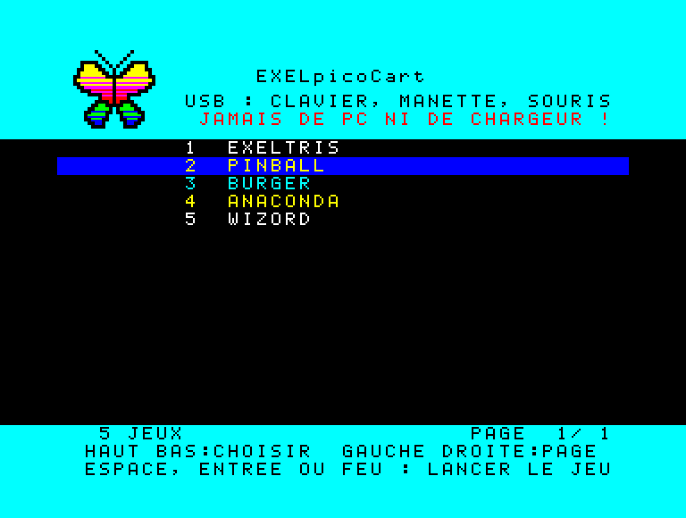

# EXELpicoCART

**La cartouche à tout faire de l'Exelvision EXL100 et de l'EXELTEL**, autour d'un Raspberry Pi Pico.
Un projet de **dada59**.


<p align="center">
  
  
</p>

---

## Présentation

L'EXELpicoCart se glisse dans le port cartouche de l'EXL100 ou de l'EXELTEL comme une cartouche
d'origine. À l'intérieur, un **Raspberry Pi Pico (RP2040)** répond au bus de la console exactement
comme l'EPROM d'une cartouche. Il peut ainsi devenir **n'importe quelle cartouche**, ou toute une
**bibliothèque de jeux**, avec un menu au démarrage.

Elle fait aussi le lien avec le matériel d'aujourd'hui. Une **manette DB9**, une **manette USB**, une
**souris** ou un **clavier USB** se branchent sur la cartouche. Le Pico les relaie **par infrarouge**,
comme la manette et le clavier Exelvision d'origine : les jeux du commerce fonctionnent tels quels.

Rien n'est à souder dans la console et rien n'est modifié : on retire la cartouche, la machine
redevient d'origine.

## Fonctionnalités

**Les jeux**
- **Bibliothèque** : jusqu'à **190 jeux** dans un menu en couleurs. On choisit aux flèches ou à la
  manette, on lance avec ENTRÉE ou le feu, et un **reset** ramène au menu.
- **ROM unique** : la cartouche se comporte comme une cartouche classique.
- **ROM à banques** pour les programmes de plus de 32 Ko (16 Ko fixes + banques de 16 Ko).

**L'Exelmémoire et les cassettes, depuis le menu**
- **Images Exelmémoire** (`.cram`, `.BKP`) recopiées dans l'Exelmémoire branchée sur la console, puis
  lancées. Elles apparaissent en cyan dans le menu.
- **Sauvegarde de l'Exelmémoire dans la cartouche** (touche **M** dans le menu). On la relit ensuite
  sur le PC, en `.cram` ou `.BKP`.
- **Cassettes BASIC** (`.k7`), en jaune dans le menu : le BASIC démarre (EXELBASIC ou EXEL BASIC
  PLUS) et `LOAD "1"` charge le programme depuis le Pico en une fraction de seconde.

**Les manettes : le relais infrarouge**
- **Manette DB9** (type Atari) sur la prise de la cartouche.
- Par un câble **USB-C OTG** : **manettes USB** des deux familles (HID générique : SNES USB,
  DualShock 4… ; Xbox 360 / One / Series et compatibles XInput), **souris** et **clavier** (AZERTY).
- Tout part vers la console par la diode infrarouge de la cartouche, **comme la manette 1 et le
  clavier Exelvision**. Aucun jeu n'est à modifier.
- Les jeux qui le prévoient lisent aussi la manette et la souris directement, par une zone d'échange
  (Exelnoid à la souris, par exemple).

**Vidéo et son**
- Lecture de **vidéos** 320 × 240 en noir et blanc ou en 8 couleurs, avec une **musique 1 bit** par
  la sortie cassette. *Big Buck Bunny* est fourni en exemple.

**Pour les développeurs**
- Des sources ouvertes : le firmware en C (Pico SDK), le menu en assembleur TMS7020, et l'outil
  **EXLPICO** (une page web).
- Une **sonde** de diagnostic, qui relève ce que la console lit vraiment, à 20 ns près.


## Démarrage rapide

1. **Ouvrez [`outils/exlpico.html`](outils/exlpico.html)** dans Chrome ou Edge. La page fonctionne
   hors ligne, sans rien installer.
2. **Choisissez la carte** en haut de la page : *linéaire* pour l'EXELpicoCart.
3. **Préparez la bibliothèque**, dans la carte *Bibliothèque de jeux (menu)* :
   - *Loader (menu)…* : choisissez `exlmenu.rom` (le menu, voir [`loader/`](loader/)) ;
   - *Ajouter des jeux, des Exelmémoires ou des cassettes…* : vos `.rom`, `.cram`, `.BKP`, `.k7` ;
   - cliquez sur **UF2 bibliothèque complète (firmware + menu + jeux)**.
4. **Copiez le fichier sur le Pico** :
   - cartouche **hors de la console**, rien de branché ;
   - maintenez le bouton **BOOT** du Pico et branchez-le en USB sur le PC, puis relâchez ;
   - un lecteur **RPI-RP2** apparaît : copiez-y le fichier `.uf2`. Le Pico redémarre tout seul.
5. **Débranchez du PC**, insérez la cartouche **console éteinte**, recto dessus (la DB9 vers le
   haut), et allumez : le menu s'affiche.

| Clavier ou manette | Souris | Action |
|---|---|---|
| ↑ ↓ | glisser vers le haut / le bas | jeu précédent / suivant |
| ← → | — | page précédente / suivante (15 jeux par page) |
| ENTRÉE, ESPACE ou feu | un clic | lancer le jeu |
| M | — | sauvegarder l'Exelmémoire dans la cartouche (si une Exelmémoire est branchée) |
| **Reset** de la console | | revenir au menu |

> ⚠️ **Jamais l'USB vers un PC ou un chargeur quand la cartouche est dans la console.** Les deux
> alimentations 5 V se retrouveraient reliées. Seuls la manette, la souris et le clavier USB, par
> l'adaptateur OTG, se branchent cartouche en place : c'est elle qui les alimente.
>
> Insérez et retirez la cartouche console éteinte, et vérifiez le sens : à l'envers, le Pico reçoit
> son alimentation inversée.

---

## EXLPICO : mode d'emploi

EXLPICO ([`outils/exlpico.html`](outils/exlpico.html)) prépare tout ce qui va dans le Pico. Il produit
des fichiers **`.uf2`** à copier sur le lecteur RPI-RP2. Tout se passe dans le navigateur : aucun
fichier ne quitte votre ordinateur. Le firmware est intégré à la page, on ne recompile jamais rien
pour changer de jeu.

La page est faite de cartes, de haut en bas.

### La carte du Pico

**Carte (brochage)** : *linéaire* pour l'EXELpicoCart, ou *support EPROM* pour un Pico soudé sur
l'empreinte d'une 27C256. Le choix est mémorisé. Avec le firmware de l'autre carte, la console ne
voit pas de cartouche.

### Une seule ROM

1. **ROM** → *Choisir la ROM…*. EXLPICO l'analyse : organisation, point d'entrée, somme de contrôle,
   zone d'échange éventuelle. Il accepte les images de 32 Ko, de 32 256 octets (depuis `$0200`),
   de 16 Ko ou de 8 Ko.
2. **Fichier .uf2** :
   - **UF2 complet (firmware + ROM)** la première fois, et après chaque mise à jour d'EXLPICO ;
   - **UF2 ROM seule** pour changer de jeu ensuite (plus rapide).

### La bibliothèque

Dans la carte **Bibliothèque de jeux (menu)** :

- **Loader (menu)…** : `exlmenu.rom`, le menu assemblé ([`loader/exlmenu.asm`](loader/exlmenu.asm)).
- **Ajouter…** : plusieurs fichiers à la fois. Chaque entrée affiche son état et la place qu'elle
  prend dans la flash :
  - **les jeux** `.rom` ;
  - **les images Exelmémoire** `.cram` (émulateurs) ou `.BKP` (sauvegarde de l'Exelmémoire) ;
  - **les cassettes** `.k7`, avec la liste de leurs programmes. Ajoutez aussi la ROM de l'**EXELBASIC**
    ou de l'**EXEL BASIC PLUS** : EXLPICO les reconnaît (« sert aussi aux cassettes »), et chaque
    cassette prend le BASIC choisi (*auto* : BASIC PLUS s'il est là).
- Les noms viennent des fichiers (20 caractères, en majuscules). Ils se **modifient** dans la liste.
  On **réordonne** les entrées avec ↑ ↓, on en **retire** avec ×, ou on clique sur **Trier par nom**.
- **UF2 bibliothèque complète (firmware + menu + jeux)**, ou **UF2 bibliothèque seule** pour ne
  changer que la liste.

Dans le menu, les images Exelmémoire sont en **cyan** et les cassettes en **jaune** :

- **Une image Exelmémoire** : le menu demande confirmation (le contenu de l'Exelmémoire sera effacé),
  la recopie et la vérifie. ENTRÉE la démarre si elle a le démarrage automatique. **S** redémarre
  la console « sans cartouche », pour les images qui se lancent depuis le menu de la console.
- **Une cassette** : le BASIC démarre, cassette rembobinée. Tapez `LOAD "1"` puis `RUN` (avec
  l'EXELBASIC, appuyez d'abord sur ESC, comme avec un magnétophone).

### Les sauvegardes de l'Exelmémoire

1. Dans le menu, avec une Exelmémoire branchée : **M**, puis ENTRÉE. Le Pico garde les **8
   dernières** sauvegardes.
2. Sortez la cartouche, branchez le Pico **seul** sur le PC, sans BOOT, et attendez 5 secondes.
3. Dans la carte **Sauvegardes de l'Exelmémoire**, cliquez sur **Lire les sauvegardes (USB)** et
   choisissez le port du Pico.
4. Pour chaque sauvegarde : **.cram** (pour les émulateurs), **.BKP**, ou **→ bibliothèque**, pour la
   recopier plus tard dans une Exelmémoire. **Effacer les sauvegardes du Pico** les supprime.

### Vidéo et version disque

Il faut la carte de 16 Mo.

- **Vidéo** (le Pico décode) : la ROM du lecteur `exemples/badapple/badapple.rom`, une vidéo `.exv`
  dans la carte **Vidéo**, puis **UF2 complet + vidéo**. `outils/exlvideo.py` convertit n'importe
  quelle vidéo (avec ffmpeg).
- **Version disque** (le Pico ne fait que servir, l'EXL100 fait tout) : `exemples/badflux/badflux.rom`
  et un film `.exf` dans la carte **Version disque**, puis **UF2 complet + disque**. Le même film peut
  être rangé dans une bibliothèque. `outils/exlflux.py` fait les films.

### Les ROM à banques

Carte **ROM** pour la ROM principale, puis carte **Banques de 16 Ko** → *Ajouter des banques…*. Elles
prennent les numéros 1, 2, 3… dans l'ordre de la liste. Finissez par **UF2 complet** ou **UF2 ROM
seule**. Les banques ne se servent qu'en ROM unique.

### Les autres cartes

- **Réglage du service** : laissez **0 / 0** (réponse immédiate, validée sur les deux machines). On y
  règle aussi la sensibilité de la souris USB.
- **Sonde (diagnostic)** : un firmware qui sert la ROM et relève chaque accès de la console. Le
  relevé se lit par USB. C'est l'outil de référence quand une cartouche « n'est pas vue ».
- **Installer sur le Pico** : le rappel de la procédure BOOT / RPI-RP2.

### Ce qu'écrit chaque fichier

- Un UF2 de **ROM unique** désactive la bibliothèque, sans effacer les jeux. Un UF2 de bibliothèque
  la remet.
- Une **vidéo** n'efface ni la ROM ni la bibliothèque.
- Les **sauvegardes de l'Exelmémoire** ne sont touchées par aucun de ces fichiers.

---

## Où en est le projet

| Fonction | Sur la machine |
|---|---|
| ROM unique, bibliothèque, retour au menu | validées, EXL100 et EXELTEL |
| Circuit imprimé EXELpicoCart | validé : Pico soudé sur EXL100 et EXELTEL ; Pico sur supports sur EXELTEL seulement |
| Relais infrarouge de la manette DB9 (jeux d'origine) | validé |
| Images Exelmémoire depuis le menu, sauvegarde dans la cartouche | validées |
| Cassettes `.k7` (PINBALL avec EXEL BASIC PLUS) | validées, EXL100 et EXELTEL |
| ROM à banques, vidéo, musique 1 bit, version disque | validées sur EXELTEL |
| Souris USB (Exelnoid) | fonctionne |
| Clavier USB, manettes USB et XInput | essayés dans les émulateurs, à confirmer sur la machine |

## Contenu du dépôt

```
README.md            cette page
LISEZMOI.md          la documentation technique complète (câblage, menu, firmware, dépannage…)
firmware/            le firmware du Pico (C, Pico SDK) et les firmwares prêts à l'emploi (uf2/)
loader/              le menu (exlmenu.asm, assembleur TMS7020) et la lecture des cassettes (k7/)
outils/              EXLPICO (exlpico.html), convertisseurs vidéo, bkp2cram.py
exemples/            jstest (test des manettes), banques, lecteurs vidéo et disque, patchs pour vos ROM
pcb/                 le circuit imprimé EXELpicoCart : KiCad, Gerber, nomenclature
boitier/             le boîtier imprimé en 3D : OpenSCAD, STL
docs/                images et planche BD de présentation (SVG, PDF)
```

**Pour aller plus loin**, [`LISEZMOI.md`](LISEZMOI.md) détaille :
- le câblage et le relais infrarouge ;
- le menu et ses règles ;
- la zone d'échange pour les nouveaux jeux ;
- la compilation du firmware (§ 9), son fonctionnement (§ 10) et la sonde ;
- le **dépannage** (§ 12).

## Remerciements et licences

- Le contour et le connecteur de la carte viennent de la carte **EXLROM** de **Brett Hallen**. Le
  montage du Pico violet suit **A8PicoCart** de **Robin Edwards**.
- Le firmware s'appuie sur le **Raspberry Pi Pico SDK** et **TinyUSB**.
- *Big Buck Bunny* : © Blender Foundation, licence CC BY 3.0 (voir `exemples/bigbuckbunny/CREDITS.txt`).
- **Aucune ROM de jeu n'est fournie.** Les patchs d'`exemples/` s'appliquent à vos propres ROM.

Licence du projet : *(à compléter)*.
